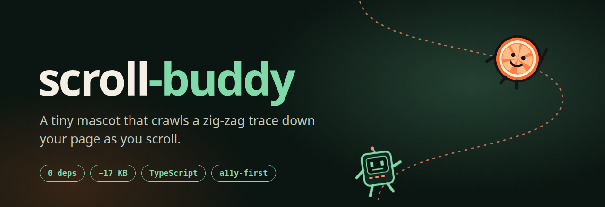
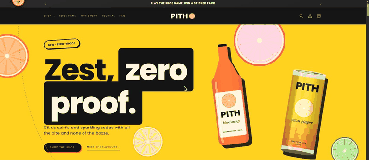
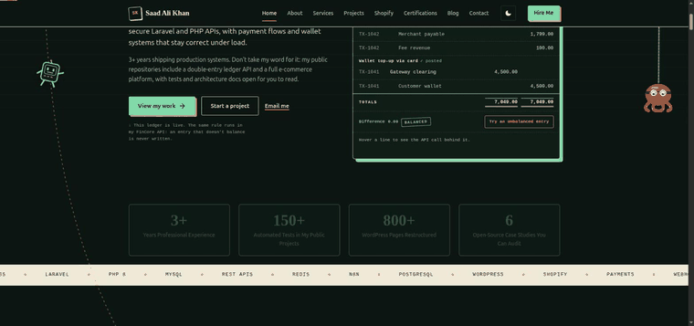
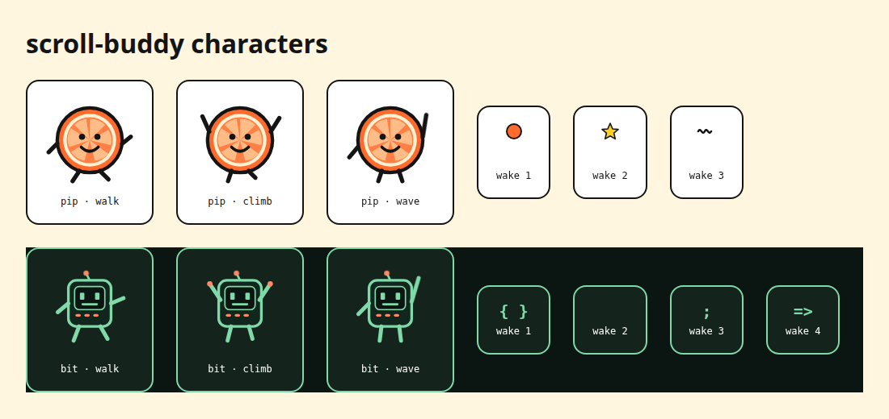

<p align="center">
  
</p>

<p align="center">
  <a href="https://www.npmjs.com/package/scroll-buddy"></a>
  <a href="https://bundlephobia.com/package/scroll-buddy"></a>
  
  
  <a href="https://github.com/ali-saad-khan/scroll-buddy/blob/main/LICENSE"></a>
</p>

<p align="center">
  <b>A mascot that follows a zig-zag trace down your page as you scroll.</b><br>
  It walks down, climbs back up, waves when you stop, drops a trail behind it and pokes your page as it passes.
</p>

---

## See it in action

Both of these are real, running sites: screen captures of the library on the page, nothing mocked up.

<table>
  <tr>
    <td width="50%" valign="top">
      
      <p><b>Pip</b> on a Shopify storefront. A citrus slice that rolls down the page, glows over dark sections, and makes cards tilt and chat bubbles bounce as it passes.<br><sub><a href="https://saadconsulting.tech/projects/pith-shopify-theme">Read the case study</a></sub></p>
    </td>
    <td width="50%" valign="top">
      
      <p><b>Bit</b> on a developer portfolio. A tiny server bot that leans into its direction of travel, waves when you pause, and leaves code glyphs behind it.<br><sub><a href="https://saadconsulting.tech">Try it live: saadconsulting.tech</a></sub></p>
    </td>
  </tr>
</table>

## Features

- **Delight without weight.** Zero dependencies, about 17 KB minified (**6.7 KB gzipped**), one `requestAnimationFrame` per scroll event.
- **Two characters included.** Pip (a citrus slice) and Bit (a server bot). Bring your own with a few SVG strings.
- **It reacts to your page.** Cards tilt, inputs jitter, headings wobble. Use the built-in effects or write your own function.
- **Respectful by default.** Off for `prefers-reduced-motion`, off on small screens, `aria-hidden`, and it never intercepts a click.
- **Framework-free.** Works in plain HTML, React, Vue, Svelte, Astro, Next.js and anything else with a DOM.
- **Safe to import anywhere.** SSR-safe, TypeScript types included, ESM + CJS + a browser bundle.
- **Themeable.** Colours are CSS variables. The trace shape, size, wake and effects are all options.

## Install

```bash
npm install scroll-buddy
```

```js
import { createBuddy } from "scroll-buddy";

const buddy = createBuddy({ character: "pip" });

// later, e.g. on unmount
buddy.destroy();
```

No bundler? Use the browser build:

```html
<script src="https://unpkg.com/scroll-buddy"></script>
<script>
  ScrollBuddy.createBuddy({ character: "bit" });
</script>
```

## Quick start

```js
import { createBuddy } from "scroll-buddy";

createBuddy({
  character: "bit",
  glowOver: ".dark-section",                    // glow while crossing dark backgrounds
  reactions: [
    { selector: ".card", effect: "tilt" },
    { selector: "input", effect: "jitter", pad: 30 },
    { selector: "h2", effect: "wobble" },
  ],
});
```

That is all you need. Scroll the page and the buddy follows.

## Characters

<p align="center">
  
</p>

| Character | Look | Behaviour |
|---|---|---|
| `"pip"` | A citrus slice with a face | Rolls down the page (720° of spin over the full scroll) |
| `"bit"` | A tiny server unit with a screen face and antenna LED | Leans into its direction of travel, drops code glyphs (`{ }`, `</>`, `;`, `=>`) |

Both have three poses:

- **walk**: scrolling down
- **climb**: scrolling back up
- **wave**: standing still on screen for a few seconds (`idleWaveMs`, default 3000)

Want your own mascot? See [Custom characters](#custom-characters).

## Reactions

Reactions make the page feel alive. Give each one a CSS selector and an effect. They fire **once per pass** and re-arm when the buddy has moved away. The test covers the whole span travelled between frames, so a fast flick of the scroll wheel still connects.

```js
createBuddy({
  reactions: [
    { selector: ".card", effect: "tilt" },
    { selector: ".stat", effect: "pop" },
    { selector: "form input", effect: "jitter", pad: 30 },
    { selector: ".hero h1", effect: (el) => el.classList.add("seen") },   // your own function
  ],
});
```

Built-in effects: `pop` · `tilt` · `bump` · `nudge` · `wobble` · `jitter` · `swing` · `flash`

Each one adds a short CSS animation class (`sb-fx-<name>`) and removes it again, so they compose with your own styles. They are disabled for reduced-motion visitors.

## Options

| Option | Default | Description |
|---|---|---|
| `character` | `"pip"` | `"pip"`, `"bit"`, or a [custom character](#custom-characters) |
| `swings` | `9` | How many times the generated trace crosses the page |
| `edge` | `6` | How close the trace runs to the page edges (0–50, in viewBox units) |
| `bend` | `0.55` | Curve tension (0.1–0.95) |
| `path` | generated | Your own path in a `100 × 1000` viewBox. Absolute `M`/`C` paths work everywhere |
| `trace` | `true` | Draw the dashed trace |
| `traceColor`, `traceWidth`, `traceDash`, `traceOpacity` | theme, `2`, `"3 9"`, `0.6` | Style the trace |
| `colors` | theme | `main`, `accent`, `ink`, `bg`, `warn`, `trace` (maps to `--sb-*` CSS variables) |
| `size` | per character | Character size in px |
| `spin` | per character | Total rotation in degrees over the page, or `"lean"` to tilt with travel |
| `idleWaveMs` | `3000` | Stand still this long on screen and the buddy waves |
| `wake` | per character | Things dropped behind it (`"none"` to disable) |
| `wakeDistance` | `42` | Distance in px between wake drops |
| `reactions` | `[]` | See [Reactions](#reactions) |
| `glowOver` | `null` | Selector of dark sections. The buddy glows while over them |
| `sound` | `false` | Soft blip on reactions with `sound: true`. Only starts after a real user gesture |
| `minWidth` | `750` | Only runs at or above this viewport width |
| `respectReducedMotion` | `true` | Off for `prefers-reduced-motion: reduce`. **Please keep this on** |
| `container` | `document.body` | Where the trace mounts. It should span the page height |
| `zIndex` | `60` | Stacking of the character |
| `injectStyles` | `true` | Inject the stylesheet. Turn off for strict CSPs ([details](#content-security-policy)) |
| `onPose` | none | `(pose) => void` called when the pose changes |
| `onReact` | none | `(element, reaction) => void` called when a reaction fires |

### Returned controller

```ts
const buddy = createBuddy(options);

buddy.enabled;   // boolean: is it currently running? (false on narrow screens or reduced motion)
buddy.pose;      // "walk" | "climb" | "wave"
buddy.refresh(); // re-measure and re-collect reaction targets after big layout changes
buddy.destroy(); // remove everything and all listeners
```

`createBuddy()` also works on the server: it returns a harmless no-op controller when there is no DOM.

## Theming

The look is driven by CSS variables, so you can theme it from your stylesheet or the `colors` option:

```css
:root {
  --sb-main:   #7FD9A8;   /* main colour of the character and trace */
  --sb-accent: #FFD21F;
  --sb-ink:    #0B1511;   /* outlines and screens */
  --sb-bg:     #11261D;   /* body fill */
  --sb-warn:   #FF8A66;   /* LEDs, vents, small highlights */
}
```

```js
createBuddy({ character: "bit", colors: { main: "#0F4D3A", bg: "#fff", ink: "#0B1511", warn: "#B3361A" } });
```

## Custom characters

A character is three SVG strings (walk, climb, wave). Only `walk` is required, missing poses fall back to it.

```js
createBuddy({
  character: {
    size: 80,
    spin: 720,                       // a rolling character. Omit (or "lean") to tilt with travel instead
    poses: {
      walk:  `<svg viewBox="0 0 100 100"><circle cx="50" cy="50" r="38" class="sb-fill-main"/></svg>`,
      climb: `<svg viewBox="0 0 100 100"><circle cx="50" cy="50" r="38" class="sb-fill-accent"/></svg>`,
      wave:  `<svg viewBox="0 0 100 100"><circle cx="50" cy="50" r="38" class="sb-fill-ink"/></svg>`,
    },
    wake: ["✦", "·"],                // glyphs, or SVG markup (anything starting with a tag like <svg)
  },
});
```

**Tips**

- Colour your artwork with the helper classes `sb-fill-main`, `sb-fill-accent`, `sb-fill-ink`, `sb-fill-bg`, `sb-fill-warn`, `sb-stroke-main`, `sb-stroke-ink`, so the `colors` option and your CSS variables keep working.
- Add `class="sb-arm"` to a group in your wave pose and it will swing back and forth.
- Pose markup is inserted as HTML. Only pass markup you trust.
- Draw the character centred in its `viewBox`. The rider is centred on the trace point.

## Framework recipes

<details>
<summary><b>React / Next.js</b></summary>

```jsx
"use client";                      // Next.js app router: this must be a client component
import { useEffect } from "react";
import { createBuddy } from "scroll-buddy";

export default function ScrollBuddy() {
  useEffect(() => {
    const buddy = createBuddy({ character: "pip", reactions: [{ selector: ".card", effect: "tilt" }] });
    return () => buddy.destroy();
  }, []);
  return null;
}
```
</details>

<details>
<summary><b>Vue 3 / Nuxt</b></summary>

```vue
<script setup>
import { onMounted, onBeforeUnmount } from "vue";
import { createBuddy } from "scroll-buddy";

let buddy;
onMounted(() => { buddy = createBuddy({ character: "bit" }); });
onBeforeUnmount(() => buddy?.destroy());
</script>
```
</details>

<details>
<summary><b>Svelte / SvelteKit</b></summary>

```svelte
<script>
  import { onMount } from "svelte";
  import { createBuddy } from "scroll-buddy";
  onMount(() => {
    const buddy = createBuddy({ character: "pip" });
    return () => buddy.destroy();
  });
</script>
```
</details>

<details>
<summary><b>Astro</b></summary>

```astro
<script>
  import { createBuddy } from "scroll-buddy";
  createBuddy({ character: "bit" });
</script>
```
</details>

<details>
<summary><b>Plain HTML, WordPress, Shopify</b></summary>

```html
<script src="https://unpkg.com/scroll-buddy"></script>
<script>
  ScrollBuddy.createBuddy({
    character: "pip",
    reactions: [{ selector: ".product-card", effect: "tilt" }],
  });
</script>
```

On Shopify, add the script to `theme.liquid` just before `</body>`, or upload `dist/scroll-buddy.iife.js` to your theme assets.
</details>

## Accessibility

Scroll-driven mascots are decoration, so they should never get in anyone's way:

- The trace and the character are `aria-hidden="true"` and `pointer-events: none`. They are not focusable and never intercept a click.
- Visitors who set **reduce motion** in their OS get a static page: the buddy does not mount. If they change the setting while the page is open, it switches off immediately.
- It does not run on small screens (default under 750px), where a mascot would only add clutter.
- Reactions only add and remove short CSS classes. Nothing is moved or hidden permanently.
- The optional sound is **off by default**, very quiet, and cannot start before a real user gesture.

## Content Security Policy

The library never writes an inline `style` attribute into markup. It sets styles through the CSSOM, which strict CSP allows. The one thing a strict `style-src` can block is the `<style>` element it injects, so use:

```js
import "scroll-buddy/style.css";
createBuddy({ injectStyles: false });
```

## How it works

1. **A path.** A smooth zig-zag (cubic curves, 100 × 1000 viewBox) is generated and stretched over the whole page height. It is sampled **once** into a lookup table with even spacing, so the character moves at constant speed and each frame is just a couple of array reads. No `getPointAtLength` in the scroll loop.
2. **Scroll progress** (0 at the top, 1 at the bottom) picks the point on the path. A `transform: translate3d` moves the character, so it stays on the compositor.
3. **A pose state machine** switches between walk, climb and wave.
4. **Reactions** use a swept-box collision test between frames, with a one-shot latch per element per pass.
5. **Layout is cached** and refreshed at most once per second while scrolling, so lazy images that shift the page self-correct.

The pure maths (path sampling, progress, pose machine, collision) is exported and unit-tested, so you can reuse it:

```js
import { zigzagPath, samplePath, pointAt, progress, createPoseState, sweepHit } from "scroll-buddy";
```

## Browser support

Current evergreen browsers (Chrome/Edge 104+, Safari 16+, Firefox 81+). Older browsers simply do not show the buddy and the page is unaffected.

## FAQ

**Will it hurt performance?** Per scroll frame it does a table lookup, one transform write and a few rect comparisons against cached boxes. There are no forced layouts in the scroll loop.

**Can I use it with a custom scroll container?** Version 1 follows the window scroll. Mount it in a `container` that spans the page height.

**Can it follow my own path?** Yes. Pass `path` as an SVG path in a `100 × 1000` viewBox. Absolute `M`/`C` paths are parsed with no DOM, and other commands use the browser's `getPointAtLength`.

**It disappeared on my phone.** That is intended. Lower `minWidth` if you want it on tablets.

**How do I show it only on some pages?** Call `createBuddy()` on those pages (or routes) and `destroy()` when leaving.

## Development

```bash
git clone https://github.com/ali-saad-khan/scroll-buddy.git
cd scroll-buddy
npm install
npm test                    # pure-logic tests plus jsdom integration tests
npm run build               # dist/: cjs, iife and css
open examples/index.html    # demo with a character switcher (run npm run build first)
```

Issues and pull requests are welcome. Please keep it dependency-free.

## Credits

Pip and Bit were drawn for this library and are MIT licensed along with the code. It was inspired by the playful scroll-driven mascots you see on creative sites, and is an independent, from-scratch implementation.

Made by [Saad Ali Khan](https://saadconsulting.tech). See the [Shopify storefronts](https://saadconsulting.tech/shopify) that use it.

## License

MIT
